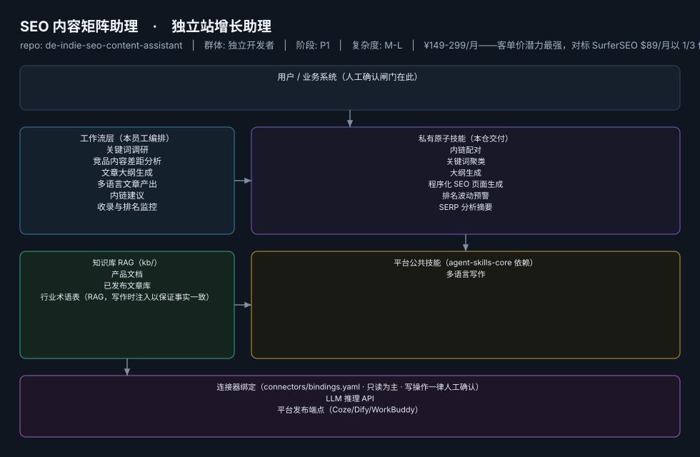

# SEO 内容矩阵助理

> 出海独立站"调研→写作→发布→监控"的 SEO 全链路闭环助理
>
> **独立站增长助理**　·　独立开发者　·　阶段 P1　·　
> 复杂度 M-L　·　¥149-299/月——客单价潜力最强，对标 SurferSEO $89/月以 1/3 价格做全链路　·　定义卡 4.4.3



## 效果（真实执行）


*上图为**真实效果对比**，不是示意图：左栏是输入材料与要求，右栏是该次执行的产出原文，
两栏取自同一次真实执行记录。*

- 完整台账：[`reports/real-run/wf-indie-seo-outline.md`](reports/real-run/wf-indie-seo-outline.md)
- 录屏与终端回放：[`workflows/wf-indie-seo-outline/docs/images/`](workflows/wf-indie-seo-outline/docs/images/)（`08-demo-run.gif` / `08-demo-run.mp4` / `04-terminal-run.png`）
- 使用示例：[`workflows/wf-indie-seo-outline/docs/使用示例.md`](workflows/wf-indie-seo-outline/docs/使用示例.md)
> 实测判定：**通过**　·　可用度 3/5　·　编造数字 0 处　·　红线命中 0 次 / 拦截 0 次


**一句话**：依赖 Google SEO 获客的出海工具站/SaaS 开发者（约占群体 1/3）

---

## 这个数字员工解决什么问题

出海独立站"调研→写作→发布→监控"的 SEO 全链路闭环助理

| 项 | 内容 |
|---|---|
| 服务对象 | 依赖 Google SEO 获客的出海工具站/SaaS 开发者（约占群体 1/3） |
| 可量化目标 | 月均产出 SEO 文章 ≥8 篇；目标词 90 天内进入 Top20 比例；自然搜索流量环比 |
| 投入产出 | 月省约 30h ≈ ¥2400 + 流量增量，回报比约 8-16 倍 |
| 需求依据 | D22、D01 |
| 分发渠道 | GitHub、Dify Marketplace、腾讯WorkBuddy Skill市场、千问办公 |

## 30 秒上手

```bash
git clone <本仓库地址> && cd de-indie-seo-content-assistant
pip install pyyaml
python3 tests/run.py            # 先跑一遍自检，确认环境与契约都对得上
```

试用（把 `<输入>` 换成本人真实材料）：

```text
请以「SEO 内容矩阵助理」的身份，帮我跑「关键词调研」。
材料如下：<输入>
要求：只使用材料里出现过的数字，缺的写 <待填>；对外文案停在待确认状态。
```

详细接入见 [`docs/01-安装与接入.md`](docs/01-安装与接入.md)。

## 仓库结构

```text
de-indie-seo-content-assistant/
├── employee.yaml          # 机器契约（能力清单 + 依赖锁）
├── dependencies.yaml      # 对 core 的外部依赖（含版本）
├── persona/               # 运行提示词 / 边界 / KPI
├── skills/                # 私有原子技能（6 个）
├── spec-bindings/         # 有意不公共化能力的本地绑定声明（0 个）
├── workflows/             # 本员工工作流（6 条）
├── kb/                    # 知识库 RAG 契约
├── connectors/            # 连接器绑定（只读为主，写操作人工确认）
├── docs/                  # 六类发布文档
└── tests/                 # 自动化多场景测试
```

## 私有原子技能（6）

| 技能 | slug | 复杂度 | 阶段 | 成熟度 |
|---|---|---|---|---|
| `内链配对` | `internal-link-matcher` | M | P2 | 契约完备 |
| `关键词聚类` | `keyword-clustering` | M | P1 | 契约完备 |
| `大纲生成` | `outline-generator` | S | P1 | 契约完备 |
| `程序化 SEO 页面生成` | `programmatic-seo-page-generator` | L | P2 | 契约完备 |
| `排名波动预警` | `rank-volatility-alert` | M | P2 | 契约完备 |
| `SERP 分析摘要` | `serp-analysis` | M | P1 | 已实现 |

## 平台公共技能依赖（1）

| 技能 | slug | 全平台复用员工数 |
|---|---|---|
| `多语言写作` | `multilingual-writing` | 3 |

> 这些技能来自 `agent-skills-core@1.0.0`，本仓库**只引用不复制**。

## Spec 绑定层（0）

（无）

> 这一族能力**有意不公共化**（与外部平台接口强绑定）。本仓不存正文，
> 只留本地绑定声明与连接器配置。

## 工作流（6）

| 工作流 | slug | 触发 | 阶段 | 调用技能数 |
|---|---|---|---|---|
| `关键词调研` | `wf-indie-seo-keyword-research` | 人工（每月） | P1 | 1 |
| `竞品内容差距分析` | `wf-indie-seo-serp-analysis` | 事件（调研后） | P1 | 1 |
| `文章大纲生成` | `wf-indie-seo-outline` | 人工 | P1 | 1 |
| `多语言文章产出` | `wf-indie-seo-multilingual` | 事件（大纲确认后） | P1 | 2 |
| `内链建议` | `wf-indie-seo-draft-internal-link` | 定时（每周） | P2 | 1 |
| `收录与排名监控` | `wf-indie-seo-effect-review` | 定时（每周） | P2 | 1 |

## 知识库与连接器

- 知识库语料：['产品文档', '已发布文章库', '行业术语表（RAG，写作时注入以保证事实一致）']
- 连接器：LLM 推理 API、平台发布端点（Coze/Dify/WorkBuddy）

## 质量与验收

| 项 | 值 |
|---|---|
| 技能文件数 | 294 |
| 多场景用例数 | 309 |
| 用例通过 | 309 |
| 验收结论 | ✅ 通过 |

完整报告：[`docs/05-验收与测试.md`](docs/05-验收与测试.md)

## 许可

专有许可，详见 [`LICENSE`](LICENSE)。
