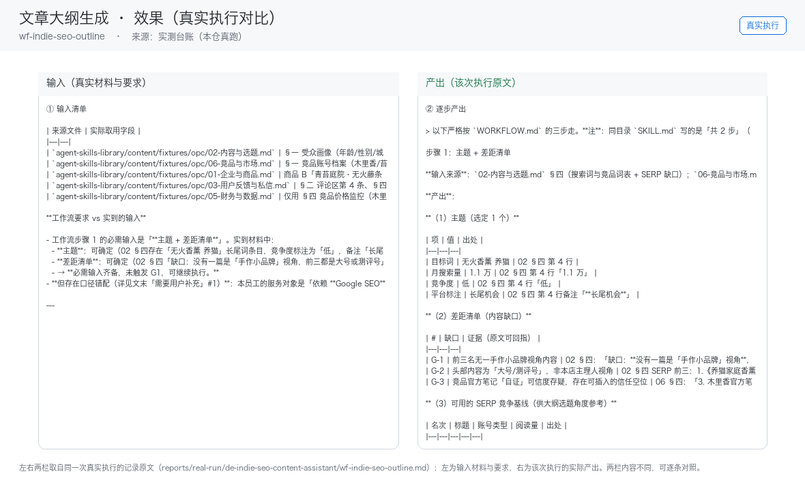

# 03 · 场景与价值

## 谁在用

依赖 Google SEO 获客的出海工具站/SaaS 开发者（约占群体 1/3）

## 三个典型场景

### 场景 A：关键词调研
- **触发**：人工（每月）
- **之前**：人工从头做一遍，每次口径不一、结果不可比
- **之后**：种子词扩展 → 搜索量/难度标注 → 关键词聚类成内容主题
- **收益**：省 6h/月 ≈ ¥480

### 场景 B：竞品内容差距分析
- **触发**：事件（调研后）
- **之后**：SERP Top10 抓取 → 内容覆盖面对比 → 差距机会清单
- **收益**：省 4h/月 ≈ ¥320

### 场景 C：文章大纲生成
- **触发**：人工
- **之后**：主题 + 差距清单 → 结构化大纲 → 人工确认
- **收益**：省 1h/篇

## 价值构成

| 维度 | 说明 |
|---|---|
| 省时间 | 月省约 30h ≈ ¥2400 + 流量增量，回报比约 8-16 倍 |
| 提一致性 | 同一能力固化成技能，口径不再因人而异 |
| 降风险 | 业务红线写死在提示词里，越界即停 |
| 可审计 | 每个数字可回指输入，产出可追溯 |

## 与人工的边界

本员工**不替代决策**。它负责把重复劳动做成清单与初稿，
把决策点（要不要发、要不要改价、要不要道歉）留给人。

## 效果证据（真实执行）

**左输入 / 右产出**的对比图，取自一次真实执行（不是示意图、不是环境探测截图）：

| 证据 | 位置 |
|---|---|
| 完整台账（输入清单 + 逐步产出 + 质检 + 如实说明） | [`../reports/real-run/wf-indie-seo-outline.md`](../reports/real-run/wf-indie-seo-outline.md) |
| 效果对比图 | [`../workflows/wf-indie-seo-outline/docs/images/00-effect.png`](../workflows/wf-indie-seo-outline/docs/images/00-effect.png) |
| 终端回放 | [`../workflows/wf-indie-seo-outline/docs/images/04-terminal-run.png`](../workflows/wf-indie-seo-outline/docs/images/04-terminal-run.png) |
| 录屏（真实执行回放） | [`../workflows/wf-indie-seo-outline/docs/images/08-demo-run.gif`](../workflows/wf-indie-seo-outline/docs/images/08-demo-run.gif)　·　[`../workflows/wf-indie-seo-outline/docs/images/08-demo-run.mp4`](../workflows/wf-indie-seo-outline/docs/images/08-demo-run.mp4) |
| 使用示例（真实输入→输出） | [`../workflows/wf-indie-seo-outline/docs/使用示例.md`](../workflows/wf-indie-seo-outline/docs/使用示例.md) |

### 该次实测的判定

| 项 | 值 |
|---|---|
| 实测判定 | 通过 |
| 可用度 | 3/5 |
| 编造数字 | 0 处 |
| 红线命中 / 拦截 | 0 / 0 |
| 必需输入缺失已标注 | 7 处 |

> 该次执行用的是**模拟材料**（虚拟企业「拾光手作」）。换成你自己的材料需要重跑一遍——
> 数值纪律要求输出里每个数字都能在输入里找到出处，换材料后出处会变。
