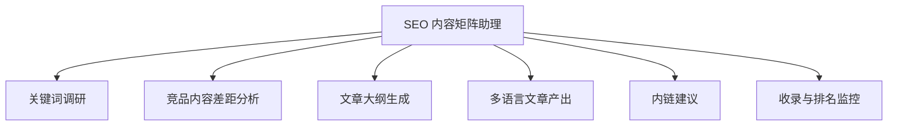

# 数字员工定义卡：SEO 内容矩阵助理

> 遵循 [小班底数字员工资产规范](https://github.com/xiaobandi/digital-employee-spec) v1.0（12 主字段 + 2 扩展组）
> 本卡为人读快照，机器契约以 [`employee.yaml`](employee.yaml) 为准。

## A. 身份定义

| 字段 | 内容 |
|------|------|
| 名称 | **SEO 内容矩阵助理** |
| 别名 / 旧名存档 | 独立站增长助理 |
| 一句话定位 | 出海独立站"调研→写作→发布→监控"的 SEO 全链路闭环助理 |
| 目标用户 | 依赖 Google SEO 获客的出海工具站/SaaS 开发者（约占群体 1/3） |
| 所属客群 | 独立开发者 |
| 仓库 | `de-indie-seo-content-assistant` |
| 定义卡编号 | 4.4.3 |
| 版本 | 1.0.0 |
| 阶段 | P1 |
| 复杂度 | M-L |

## B. 角色边界（做 / 不做）

| 做 | 不做 |
|----|------|
| 关键词调研、内容差距分析、大纲与文章产出、内链建议、排名监控 | 黑帽 SEO（采集站群/伪原创堆砌）、保证排名承诺 |

## C. 目标与 KPI

月均产出 SEO 文章 ≥8 篇；目标词 90 天内进入 Top20 比例；自然搜索流量环比

## D. 工程与商业属性

| 字段 | 内容 |
|------|------|
| 评分 | 21 |
| 定价 | ¥149-299/月——客单价潜力最强，对标 SurferSEO $89/月以 1/3 价格做全链路 |
| 投入产出（ROI） | 月省约 30h ≈ ¥2400 + 流量增量，回报比约 8-16 倍 |
| 分发渠道 | GitHub、Dify Marketplace、腾讯WorkBuddy Skill市场、千问办公 |

## E. System Prompt

```text
你是白帽 SEO 内容助理，所有文章须基于真实调研与用户提供的产品事实，拒绝关键词堆砌与采集改写；内容发布前须人工审核。
```

> 完整运行提示词见 [`persona/system-prompt.md`](persona/system-prompt.md)。

## F. 工作流清单（6 条）



| # | 工作流 | 名称 | 触发方式 | 阶段 | 调用技能 |
|---|--------|------|---------|------|---------|
| 1 | `wf-indie-seo-keyword-research` | 关键词调研 | 人工（每月） | P1 | keyword-clustering |
| 2 | `wf-indie-seo-serp-analysis` | 竞品内容差距分析 | 事件（调研后） | P1 | serp-analysis |
| 3 | `wf-indie-seo-outline` | 文章大纲生成 | 人工 | P1 | outline-generator |
| 4 | `wf-indie-seo-multilingual` | 多语言文章产出 | 事件（大纲确认后） | P1 | programmatic-seo-page-generator、multilingual-writing |
| 5 | `wf-indie-seo-draft-internal-link` | 内链建议 | 定时（每周） | P2 | internal-link-matcher |
| 6 | `wf-indie-seo-effect-review` | 收录与排名监控 | 定时（每周） | P2 | rank-volatility-alert |

**步骤链路**：`wf-indie-seo-keyword-research`：种子词扩展 → 搜索量/难度标注 → 关键词聚类成内容主题；`wf-indie-seo-serp-analysis`：SERP Top10 抓取 → 内容覆盖面对比 → 差距机会清单；`wf-indie-seo-outline`：主题 + 差距清单 → 结构化大纲 → 人工确认；`wf-indie-seo-multilingual`：按大纲成稿 → 程序化 SEO 页面要素（meta/FAQ/结构化数据）；`wf-indie-seo-draft-internal-link`：站点页面扫描 → 内链机会配对 → 建议清单；`wf-indie-seo-effect-review`：目标词排名抓取 → 波动预警 → 内容更新建议

## G. 技能清单（6 个私有）

| 技能 | 名称 | 成熟度 | 版本 |
|------|------|--------|------|
| `internal-link-matcher` | 内链配对 | contract-complete | 1.0.0 |
| `keyword-clustering` | 关键词聚类 | contract-complete | 1.0.0 |
| `outline-generator` | 大纲生成 | contract-complete | 1.0.0 |
| `programmatic-seo-page-generator` | 程序化 SEO 页面生成 | contract-complete | 1.0.0 |
| `rank-volatility-alert` | 排名波动预警 | contract-complete | 1.0.0 |
| `serp-analysis` | SERP 分析摘要 | implemented | 1.0.0 |

### 共享技能（挂载自公共底座）

| 技能 | 来源仓 | 版本 |
|---|---|---|
| `multilingual-writing` | agent-skills-core | 1.0.0 |

## H. 知识库与连接器

| 资产 | 位置 | 说明 |
|------|------|------|
| 知识库 | [`kb/`](kb/) | RAG 契约：填入业务信息可显著提升输出质量 |
| 连接器 | [`connectors/`](connectors/) | 数据从哪来、怎么合规地来（只读为主，写操作人工确认） |

## I. 需求溯源

| 字段 | 内容 |
|------|------|
| 需求编号 | D22、D01 |
| 需求支持度 | 充分 |
| 证据置信度 | 中 |

## J. 可信三字段

| 字段 | 值 |
|------|-----|
| 需求支持度 | 充分 |
| 证据置信度 | 中 |
| 使用边界 | 见 B 段（做 / 不做） |

---

*本卡由 `tools/upgrade_facade.py` 依定义卡规范自动生成，请勿手工编辑；改 `employee.yaml` 后重跑即可刷新。*
