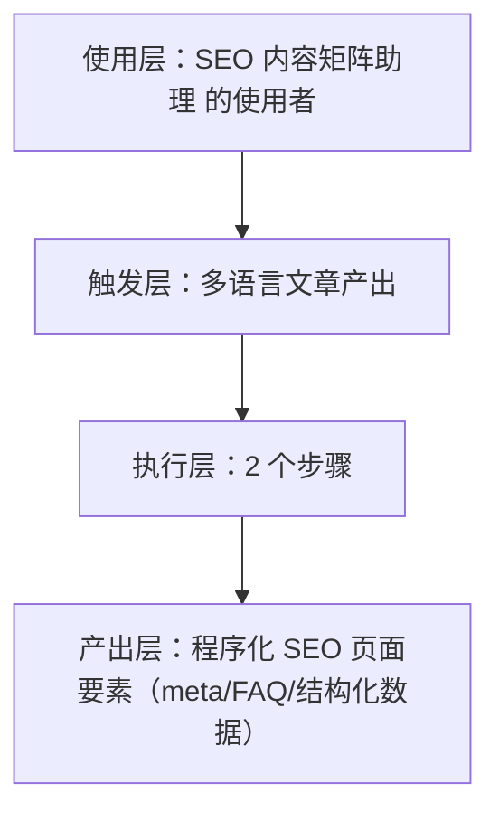
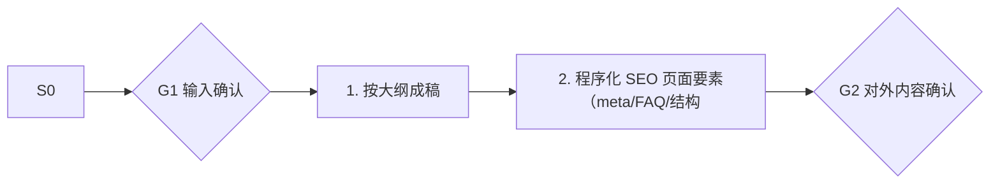

# 多语言文章产出 · 架构与流程图

## 本工作流的四层结构

| 层 | 内容 |
|---|---|
| 使用层 | 依赖 Google SEO 获客的出海工具站/SaaS 开发者（约占群体 1/3）；员工定位：出海独立站"调研→写作→发布→监控"的 SEO 全链路闭环助理 |
| 触发层 | 关键词 / 显式点名「多语言文章产出」；触发方式：事件（大纲确认后） |
| 执行层 | 按大纲成稿 → 程序化 SEO 页面要素（meta/FAQ/结构化数据） |
| 产出层 | 程序化 SEO 页面要素（meta/FAQ/结构化数据） |

## 执行流程

## 步骤职责表

| # | 步骤 | 承担者 | 为什么 |
|---|---|---|---|
| 1 | 按大纲成稿 | 模型 | 需要读懂语境，不可用固定规则替代 |
| 2 | 程序化 SEO 页面要素（meta/FAQ/结构化数据） | 模型 | 需要读懂语境，不可用固定规则替代 |

⚠️ 尚未补齐：图中的步骤来自注册表口径，未逐条实跑校验；实跑后请同步修订本页（`发布标准.md` 第六项：通读一遍，不得出现重复填充句）。
